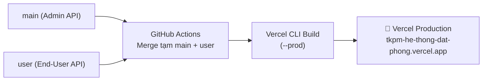

<div align="center">

# 🏫 Hệ Thống Đặt Phòng Học & Phòng Họp (Frontend)

**Ứng dụng web quản lý & đặt phòng học, phòng họp cho trường học và doanh nghiệp**  
Xây dựng theo kiến trúc **Feature-based + SOLID**, tách biệt rõ vai trò **Quản trị viên (Admin)** và **Người dùng cuối (End-User)**.

<p>
  <a href="https://tkpm-he-thong-dat-phong.vercel.app">
    
  </a>
  <a href="https://github.com/CaoSonn59/TKPM-he-thong-dat-phong/actions/workflows/deploy.yml">
    
  </a>
</p>

<p>
  
  
  
  
  
  
</p>

[🌐 Xem bản chạy thử (Vercel)](https://tkpm-he-thong-dat-phong.vercel.app) · [📐 Kiến trúc (ARCHITECTURE.md)](./ARCHITECTURE.md) · [📝 Nhật ký phát triển (DEVLOG.md)](./DEVLOG.md)

</div>

---

## ✨ Tính năng chính

<table>
  <tr>
    <th width="50%">🛡️ Phân hệ Quản trị viên (Admin)</th>
    <th width="50%">👤 Phân hệ Người dùng (End-User)</th>
  </tr>
  <tr>
    <td valign="top">
      <ul>
        <li><strong>Tổng quan:</strong> Thống kê nhanh, lịch sử dụng phòng hôm nay (timeline 07:00–19:00), cảnh báo yêu cầu chờ duyệt.</li>
        <li><strong>Quản lý đặt phòng:</strong> Duyệt, từ chối, hủy khẩn cấp kèm lý do; lọc theo trạng thái và phân trang.</li>
        <li><strong>Quản lý phòng:</strong> Thêm/sửa phòng, sức chứa, tiện ích, trạng thái bảo trì (tự chặn bảo trì nếu còn lịch sắp tới).</li>
        <li><strong>Quản lý người dùng & nhóm:</strong> CRUD tài khoản, kích hoạt/ngưng sử dụng, phân nhóm thành viên.</li>
        <li><strong>Báo cáo & thống kê:</strong> Biểu đồ số lượt đặt theo phòng, theo nhóm và tỷ lệ chấp nhận theo khoảng thời gian.</li>
      </ul>
    </td>
    <td valign="top">
      <ul>
        <li><strong>Tìm phòng trống:</strong> Lọc theo ngày, khung giờ, sức chứa tối thiểu, tiện ích và nhóm sử dụng (tối ưu cho cả Desktop & Mobile).</li>
        <li><strong>Xem chi tiết phòng:</strong> Xem vị trí, sức chứa, tiện ích và 10 đánh giá gần nhất từ người dùng.</li>
        <li><strong>Đặt phòng trực tuyến:</strong> Gửi yêu cầu đặt phòng cá nhân hoặc theo nhóm; tự phát hiện trùng lịch (<code>409 Conflict</code>) và tải lại danh sách.</li>
        <li><strong>Lịch sử & chi tiết đặt phòng:</strong> Theo dõi trạng thái lịch cá nhân & lịch nhóm, hủy lịch trước giờ diễn ra.</li>
        <li><strong>Đánh giá & tài khoản:</strong> Đánh giá sao + tag nhanh trong vòng 1 tháng sau sử dụng; xem hồ sơ, nhóm trực thuộc và đổi mật khẩu.</li>
      </ul>
    </td>
  </tr>
</table>

---

## 🌿 Chiến lược nhánh & Tự động Deploy (CI/CD)

Repository giữ **`main`** và **`user`** là **2 nhánh độc lập trên GitHub**, nhưng tự động gộp tạm trong GitHub Actions để deploy bản hoàn chỉnh lên Vercel Production:



| Nhánh | Vai trò |
|---|---|
| `main` | Kiến trúc chuẩn Feature-based + SOLID, tích hợp đầy đủ **API Quản trị viên (Admin)**. |
| `user` | Tích hợp đầy đủ **API Người dùng cuối (End-User)**, đổi mật khẩu, xóa sạch dữ liệu mẫu và tối ưu Responsive Mobile/Desktop. |

---

## 🔌 Tóm tắt API đã tích hợp

Base URL lấy từ biến môi trường `VITE_API_URL` (mặc định `http://localhost:8080/api/v1`), xác thực bằng `Authorization: Bearer <token>`.

| Nhóm | Endpoints |
|---|---|
| **Xác thực & Tài khoản** | `POST /auth/login` · `GET /auth/me` · `PUT /auth/change-password` |
| **Phòng** | `GET /rooms/available` · `GET /rooms/:id` · `GET / POST /admin/rooms` · `PUT /admin/rooms/:id` |
| **Đặt phòng** | `POST /bookings` · `GET /bookings/my` · `GET /bookings/:id` · `PUT /bookings/:id/cancel`<br/>`GET /admin/bookings` · `PUT /admin/bookings/:id/{approve\|reject\|cancel}` |
| **Đánh giá** | `POST /bookings/:id/feedback` · `PUT /bookings/:id/feedback` |
| **Người dùng & Nhóm** | `GET /my/groups` · `GET /my/groups/:id`<br/>`GET / POST /admin/users` · `PUT /admin/users/:id`<br/>`GET / POST /admin/groups` · `GET / PUT / DELETE /admin/groups/:id` |

---

## 🏗️ Kiến trúc thư mục

Tổ chức theo mô hình phân tầng 1 chiều (`app → layouts → features → shared`) và áp dụng nghiêm ngặt **SOLID** (chi tiết xem [ARCHITECTURE.md](./ARCHITECTURE.md)):

```text
src/
├─ app/           # Composition root: main.tsx (QueryClient, configureHttp), App.tsx (Routes), index.css
├─ layouts/       # Khung trang dùng chung: AdminLayout, AdminPage, UserLayout
├─ features/      # Mỗi nghiệp vụ 1 thư mục độc lập:
│  ├─ auth/       # Đăng nhập, phiên JWT (zustand persist), hồ sơ & đổi mật khẩu
│  ├─ bookings/   # Tìm phòng, đặt phòng, lịch sử (End-User) & duyệt lịch (Admin)
│  ├─ rooms/      # Quản lý phòng & tìm phòng trống
│  ├─ reviews/    # Đánh giá phòng & gửi/sửa phản hồi
│  ├─ users/      # Quản lý tài khoản người dùng
│  ├─ groups/     # Quản lý nhóm & nhóm của tôi
│  ├─ dashboard/  # Tổng quan & timeline hôm nay (Admin)
│  ├─ reports/    # Báo cáo & biểu đồ thống kê (Admin)
│  └─ toast/      # Hệ thống thông báo toast
└─ shared/        # Thành phần dùng chung thuần túy (KHÔNG import từ features/)
   ├─ api/        # HTTP client (http.ts, ApiError, xử lý 401)
   ├─ lib/        # Format ngày giờ & đồng hồ thực (format.ts, clock.ts)
   └─ ui/         # Icon, Modal, Drawer, Confirm, MultiPick, Skeleton, Table
```

---

## 🚀 Hướng dẫn cài đặt & chạy cục bộ

### Yêu cầu môi trường
- **Node.js** `>= 22` (khuyến nghị Node 24 LTS để chạy `node --test` trực tiếp với TypeScript)
- **npm** `>= 10`

### 1. Clone & cài đặt thư viện
```bash
git clone https://github.com/CaoSonn59/TKPM-he-thong-dat-phong.git
cd TKPM-he-thong-dat-phong
npm install
```

### 2. Cấu hình biến môi trường *(tùy chọn)*
Tạo file `.env.local` ở thư mục gốc nếu backend chạy ở địa chỉ khác mặc định (`http://localhost:8080/api/v1`):
```env
VITE_API_URL=http://localhost:8080/api/v1
```

### 3. Các lệnh thường dùng
| Lệnh | Mô tả |
|---|---|
| `npm run dev` | Khởi chạy server phát triển Vite (HMR) |
| `npm run build` | Kiểm tra TypeScript (`tsc`) và đóng gói production (`dist/`) |
| `npm test` | Chạy toàn bộ unit test (`src/**/*.test.ts`) bằng `node --test` |
| `npx tsc --noEmit --noUnusedLocals` | Kiểm tra chặt kiểu dữ liệu và biến/import thừa |

---

<div align="center">
  <sub>Đồ án môn <strong>Kiến trúc & Thiết kế Phần mềm (KT&TKPM)</strong> · Deploy tự động bởi GitHub Actions & Vercel</sub>
</div>
